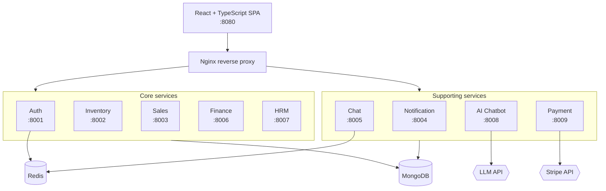

# ERP Microservices Platform

A full-stack Enterprise Resource Planning system built as 10 independent microservices — covering authentication, inventory, sales, finance, HR, payments, real-time chat, and an AI assistant with RAG-based retrieval over business data.

[](https://github.com/mahmudul-islam32/erp-ai-microservices/actions/workflows/ci.yml)
[](LICENSE)


---

## Screenshots

> **TODO — highest-impact remaining task.** Run the stack, capture four screens, save them to
> `docs/images/`, then delete this block and uncomment the table below.

<!--
| Dashboard | Inventory |
|---|---|
|  |  |

| AI Assistant | Payments |
|---|---|
|  |  |
-->

---

## Architecture

Each business domain runs as an independently deployable service behind an Nginx reverse proxy. Services communicate over HTTP, share a MongoDB instance per-database, and use Redis for caching and session state.



### Services

| Service | Port | Stack | Responsibility |
|---|---|---|---|
| Frontend | 8080 | React 18 + TypeScript + Vite | SPA, Redux Toolkit state, Tailwind UI |
| Auth | 8001 | FastAPI | JWT auth, RBAC, sessions, audit logging |
| Inventory | 8002 | NestJS | Products, warehouses, stock movements |
| Sales | 8003 | FastAPI | Orders, quotes, customer management |
| Notification | 8004 | FastAPI | WebSocket push, email dispatch |
| Chat | 8005 | FastAPI | Internal messaging over WebSocket |
| Finance | 8006 | FastAPI | Ledger, invoicing, reporting |
| HRM | 8007 | FastAPI | Employees, payroll, leave management |
| AI Chatbot | 8008 | FastAPI | RAG assistant over ERP data |
| Payment | 8009 | FastAPI | Stripe integration, webhooks |

**Infrastructure:** MongoDB (external/managed), Redis 7 (containerized), Nginx, Docker Compose, Terraform + GitHub Actions for AWS EC2 deploys.

---

## Quick start

**Prerequisites:** Docker & Docker Compose, a MongoDB connection string.

```bash
git clone https://github.com/mahmudul-islam32/erp-ai-microservices.git
cd erp-ai-microservices

# Scaffold your local env file
cp .env.example .env
./scripts/generate-secrets.sh   # prints strong JWT/Redis/Mongo secrets to paste into .env

# Bring the stack up
docker compose up -d

# Seed demo data (optional)
./scripts/seed-all-services-docker.sh
```

The app is served at **http://localhost:8080**. Each service exposes interactive OpenAPI docs at `http://localhost:<port>/docs`.

```bash
./check-health.sh    # verify every service is responding
docker compose logs -f auth-service
```

> **Note:** `.env` is gitignored and must never be committed. `.env.example` documents every required variable.

---

## Testing

```bash
# Auth service test suite — 36 tests covering JWT, RBAC, and password policy
cd auth-service && pip install -r requirements-dev.txt && pytest

# Python lint across all services
ruff check .

# Frontend type check, build and lint
cd erp-frontend && npm ci && npm run typecheck && npm run build && npm run lint
```

CI runs the auth-service tests, Ruff, a frontend type check and build, and Gitleaks secret scanning on every push and pull request.

ESLint is not gated yet: a handful of unused-variable errors remain, and `no-explicit-any` is a warning until the frontend can compile under `strict: true`.

---

## Project structure

```
├── auth-service/          FastAPI — authentication & RBAC (has test suite)
├── inventory-service/     NestJS — products & stock
├── sales-service/         FastAPI — orders & customers
├── finance-service/       FastAPI — ledger & invoicing
├── hrm-service/           FastAPI — employees & payroll
├── payment-service/       FastAPI — Stripe integration
├── notification-service/  FastAPI — WebSocket notifications
├── chat-service/          FastAPI — internal messaging
├── ai-chatbot-service/    FastAPI — RAG assistant
├── erp-frontend/          React 18 + TypeScript SPA
├── terraform/             AWS infrastructure as code
├── scripts/               Setup, seeding, deployment helpers
└── docs/                  Architecture, deployment, API reference
```

---

## Documentation

| Document | Contents |
|---|---|
| [Architecture](docs/ARCHITECTURE.md) | Service boundaries, data flow, design decisions |
| [Installation](docs/INSTALLATION.md) | Detailed setup, configuration, troubleshooting |
| [Deployment](docs/DEPLOYMENT.md) | Docker Compose production deployment |
| [AWS Deployment](docs/AWS_DEPLOYMENT.md) | EC2 + Terraform provisioning |
| [CI/CD](docs/CI_CD.md) | GitHub Actions pipeline and required secrets |
| [API Reference](docs/API.md) | Endpoint reference |
| [Payments](docs/PAYMENTS.md) | Stripe integration and webhook handling |
| [User Guide](docs/USER_GUIDE.md) | End-user walkthrough |

---

## License

MIT — see [LICENSE](LICENSE).
